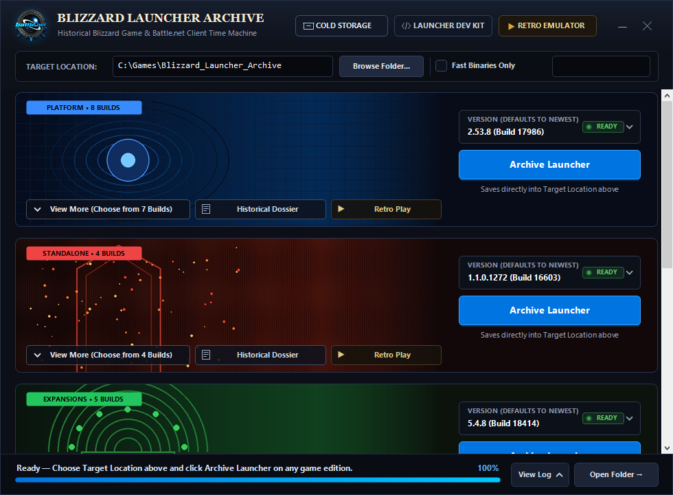

<div align="center">


# BlizzLauncherArchive
### The Historical Archival Suite & Retro Player for Blizzard & Battle.net Launchers
**by Elite Level Software**

[](https://github.com/EliteLevelSoftware/BlizzLauncherArchive/releases)
[](https://dotnet.microsoft.com/)
[](LICENSE)
[](https://github.com/EliteLevelSoftware/BlizzLauncherArchive/releases)
[](https://github.com/EliteLevelSoftware/BlizzLauncherArchive/releases)
[](https://github.com/EliteLevelSoftware/BlizzLauncherArchive/releases/latest)

**[⬇️ Download the latest version](https://github.com/EliteLevelSoftware/BlizzLauncherArchive/releases/latest)**

</div>

---

**BlizzLauncherArchive** (v1.0.6) is a standalone, zero-dependency open-source archival suite, retro player, and developer toolkit dedicated to preserving the historical lineage of Blizzard Entertainment standalone game launchers and Battle.net desktop applications.

From the 1998 GDI autoplay menus of *StarCraft: Brood War* and the iconic 2011–2014 standalone *Diablo III* launchers to the evolution of the modern *Battle.net Desktop App* (`bna` & `agent`), this application provides a unified interface to browse, inspect, emulate, download, and archive every milestone release.

> ### **[Download `BlizzLauncherArchive.exe` v1.0.6 (Standalone Windows x64 - Zero Dependencies)](https://github.com/EliteLevelSoftware/BlizzLauncherArchive/releases/download/v1.0.6/BlizzLauncherArchive.exe)**
> - **Version:** `v1.0.6`
> - **SHA-256:** `34c23f03c06cec28241333e1ea63c6dba1083bd8c9d29d3e7737202c528ff409` ([`release/SHA256SUMS.txt`](release/SHA256SUMS.txt))
> - **Historical Catalog & Reference:** [`docs/ARCHIVAL_CATALOG.md`](docs/ARCHIVAL_CATALOG.md)
> - **Server & Launcher Developer Integration Guide:** [`docs/SERVER_INTEGRATION_GUIDE.md`](docs/SERVER_INTEGRATION_GUIDE.md)
> - Or browse **[GitHub Releases](https://github.com/EliteLevelSoftware/BlizzLauncherArchive/releases)**



---

## Features

### 🎮 Accordion Game Drawers Organized by Game Name
- **Eight Dedicated Game Tiles:** Individual tiles categorized by exact game identity:
  - **Battle.net Desktop App** (8 milestone builds)
  - **Diablo III** (4 standalone & beta builds)
  - **World of Warcraft** (5 expansion standalone launchers)
  - **StarCraft II** (2 standalone builds)
  - **StarCraft: Brood War** (Classic GDI autoplay)
  - **Warcraft III** (Reign of Chaos & The Frozen Throne)
  - **Diablo II** (Lord of Destruction CD-ROM autoplay)
  - **Hearthstone** (Early standalone beta launcher)
- **Collapsible Drawers:** Smooth reflowing accordion view with atmospheric banner artwork, category segment tabs, and 3-column chip grids.
- **Animated Breathing Dots:** Pulsing visual indicators reflecting catalog status, active transfers, and archive integrity.

### 🛡️ Anti-AutoUpdate Engine & Local Agent Shim
- **Zero-Hang Offline Launching:** Classic standalone launchers (such as `Diablo III Launcher.exe`) originally checked for updates via dead Blizzard CDN servers (`enUS.patch.battle.net:1119`), causing modern launches to hang on *"Updating Blizzard Update Agent...."*.
- **Integrated Binary Patcher:** Automatically patches legacy bootstrapper dispatchers to bypass dead update servers while safely preserving the untouched original executable as `.bak`.
- **Local Agent Shim Server:** Built-in lightweight localhost mock server (`--shim`) delivering authentic JSON payloads so historical WebKit and Qt4 parchment UIs render immediately in offline preservation mode without requiring an installed game client.

### 📜 Retro Launcher Player
- Recreates the authentic standalone launcher experience with vintage community bulletins, realm status indicators, options dialog, and direct game launch bridges.
- Enables retro launcher showcase and exploration without tying to massive multi-gigabyte modern game installations.

### 💾 Cold Storage Bulk Archival Suite
- Designed for collectors and server preservationists: point the tool to any backup directory, external SSD, or NAS share.
- Features live inventory detection: instantly see which versions are already secured and which are missing.
- Generates master `ARCHIVE_INDEX.json`, `SHA256SUMS.txt`, individual `VERSION_INFO.txt`, and executable batch scripts for every archived version.

### 📖 Historical Dossier Database
- View in-depth dossiers for each preserved launcher version.
- Detailed historical background, release context, technical architecture (Win32 GDI, DirectX, MPQ assets, Qt4/Qt5, CEF/Chromium, TACT/NGDP), trivia, and authentic release quotes.

### 🛠️ Private Server Launcher Integration Kit
- Embedded developer suite providing ready-to-run launcher wrappers and server redirect code in:
  - **C# / .NET**
  - **Electron / Node.js**
  - **Python**
  - **PowerShell**
  - **Windows Batch**
  - **C++ (Win32)**

### ⚡ Dual Mode: Modern GUI + Headless CLI
- Run as an interactive Windows Forms desktop application, or script headless downloads and backups in automated environments and server pipelines.

---

## Historical Launcher Catalog

Preserving **24 milestone versions** across eight game families:

| Game | Version / Build | Era | Highlights |
| :--- | :--- | :--- | :--- |
| **Battle.net** | `bnet-beta-1.0.8` | Jun 2013 | Early Open Beta of the unified Battle.net Desktop client (`1.0.8.4209`). |
| **Battle.net** | `bnet-rebrand-1.9.1` | Mar 2017 | "Blizzard App" rebranding era launcher (`1.9.1.9392`). |
| **Battle.net** | `bnet-modern-1.30.2` | Oct 2020 | Final pre-2.0 release before the major visual overhaul (`1.30.2.11974`). |
| **Battle.net** | `bnet-v2-launch-2.0.0` | Jan 2021 | Version 2.0 complete redesign with expanded social hub (`2.0.0.12694`). |
| **Battle.net** | `bnet-stable-2.39.0` | Nov 2024 | Modern stable Battle.net desktop distribution (`2.39.0.15212`). |
| **Battle.net** | `bnet-latest-2.53.8` | Jan 2026 | Current live production client (`2.53.8.17986`). |
| **Battle.net** | `bnet-agent-legacy` | 2014 | Classic Battle.net update daemon (`1.18.0.3086`). |
| **Battle.net** | `bnet-agent-modern` | 2026 | Modern TACT/NGDP local update daemon (`2.42.0.9873`). |
| **Diablo III** | `d3-beta-1.0.0.7447` | Sep 2011 | Friends & Family Closed Beta standalone launcher (`1.0.0.365`, Build 7447). |
| **Diablo III** | `d3-beta-1.0.0.9359` | Apr 2012 | Open Beta weekend stress test launcher (`1.0.0.729`, Build 9359). |
| **Diablo III** | `d3-retail-1.0.8a` | May 2012 – May 2013 | Authentic retail vanilla launcher (`1.1.0.1272`, Build 16603). |
| **Diablo III** | `d3-ros-beta-21962` | Nov 2013 | Reaper of Souls Closed Beta launcher (`1.4.0.1820`, Build 21962). |
| **World of Warcraft** | `wow-vanilla-1.1.0` | Nov 2004 | Original CD-ROM launcher with realm selector (`1.1.0`, Build 3988). |
| **World of Warcraft** | `wow-tbc-2.0.1` | Jan 2007 | The Burning Crusade Dark Portal launcher (`2.0.1`, Build 6180). |
| **World of Warcraft** | `wow-wotlk-3.0.1` | Oct 2008 | Wrath of the Lich King Icecrown launcher (`3.0.1`, Build 8874). |
| **World of Warcraft** | `wow-cataclysm-4.0.0` | Oct 2010 | Revolutionary streaming game client launcher (`4.0.0`, Build 12911). |
| **World of Warcraft** | `wow-mop-5.0.4` | Aug 2012 | Final standalone WoW launcher before Battle.net bundling (`5.0.4`, Build 16016). |
| **StarCraft II** | `sc2-beta-0.2.0` | Feb 2010 | Wings of Liberty Closed Beta launcher (`0.2.0`, Build 13891). |
| **StarCraft II** | `sc2-hots-2.0.4` | Mar 2013 | Heart of the Swarm streaming launcher (`2.0.4`, Build 24944). |
| **StarCraft: Brood War** | `sc-broodwar-1.0.0` | Nov 1998 | Classic 640x480 GDI autoplay launcher with Raynor and Kerrigan art. |
| **Warcraft III** | `wc3-roc-1.00` | Jul 2002 | Reign of Chaos autoplay autorun with Thrall art (`1.00`, Build 2002). |
| **Warcraft III** | `wc3-tft-1.26a` | Mar 2011 | The Frozen Throne v1.26a standalone patcher and launcher (`1.26.0.6401`). |
| **Diablo II** | `d2-lod-1.14d` | Mar 2016 | Lord of Destruction official standalone patcher and launcher (`1.14.3.71`). |
| **Hearthstone** | `hearthstone-beta-1.0` | Aug 2013 | Standalone Closed Beta launcher prior to Battle.net integration (`1.0.0`, Build 3890). |

For complete technical specifications, configurations, and SHA-256 hashes, see [ARCHIVAL_CATALOG.md](docs/ARCHIVAL_CATALOG.md).

---

## CLI Reference

`BlizzLauncherArchive` can be run in headless mode for scripting, CI/CD, and server pipelines:

```cmd
# List all 24 historical catalog entries with versions and sizes
BlizzLauncherArchive.exe --list-versions

# Download a specific launcher by version ID
BlizzLauncherArchive.exe --version d3-retail-1.0.8a --dir "C:\Archives\Launchers"

# Download standalone core executable only
BlizzLauncherArchive.exe --version d3-retail-1.0.8a --dir "C:\Archives\Launchers" --binaries-only

# Start local legacy Agent shim server
BlizzLauncherArchive.exe --shim 11190

# Apply Anti-AutoUpdate bypass patch to a launcher executable
BlizzLauncherArchive.exe --patch "C:\Archives\Launchers\Diablo III Launcher.exe"

# Archive all launchers for an entire game
BlizzLauncherArchive.exe --game Diablo3 --dir "D:\ColdStorage\Diablo3"

# Perform bulk backup across all games
BlizzLauncherArchive.exe --backup --dir "E:\BlizzardArchives"

# Start the Retro Launcher Player
BlizzLauncherArchive.exe --retro-launch
```

---

## Building from Source

### Prerequisites
- Windows 10 or 11 (64-bit)
- [.NET 10.0 SDK](https://dotnet.microsoft.com/)

### Compilation
```cmd
git clone https://github.com/EliteLevelSoftware/BlizzLauncherArchive.git
cd BlizzLauncherArchive\src
dotnet build -c Release
```

### Publishing Single-File Binary
```cmd
dotnet publish -c Release -r win-x64 --self-contained true -p:PublishSingleFile=true -o ..\release
```

The resulting standalone executable `BlizzLauncherArchive.exe` will be located in the `release/` directory.

---

## Integration & Private Servers

For guides on how to connect preserved launchers to custom game server emulators (e.g. Mooege, D3Classic, TrinityCore, AzerothCore, SC2Allin1), see our [SERVER_INTEGRATION_GUIDE.md](docs/SERVER_INTEGRATION_GUIDE.md).

---

## License

This project is released under the [MIT License](LICENSE).  
Copyright © 2026 Elite Level Software.
